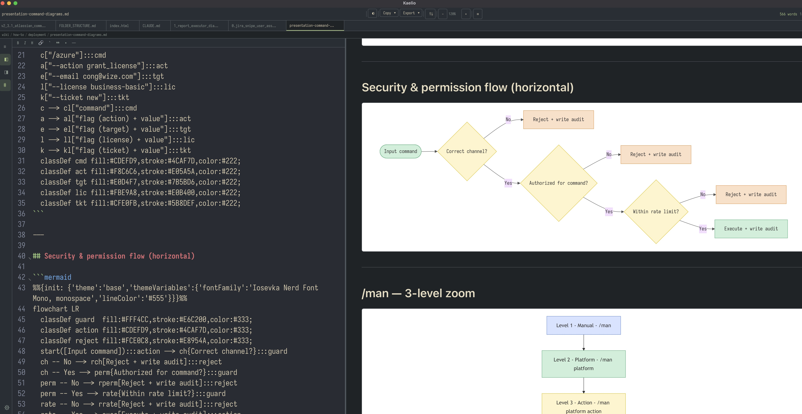
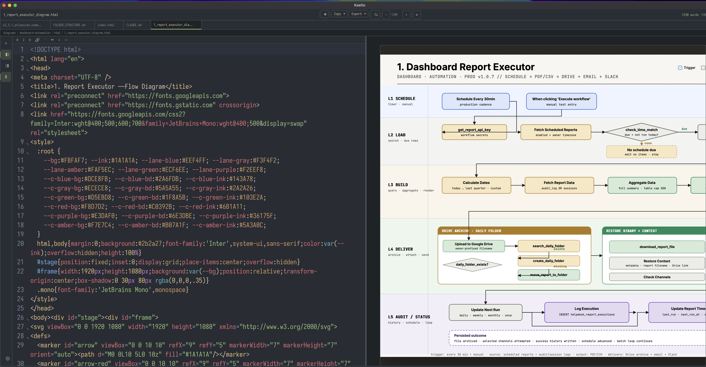

# Kaelio

**Friendly AI-generated, human-reading.**

A fast, lightweight Markdown editor built with Tauri 2 + Rust. Open any `.md` file and get live preview, Mermaid diagrams, math, and Git-backed history — no vault, no config, just open and go.




## Why Kaelio

- ⚡ **Renders everything inline** — Mermaid diagrams, KaTeX math, callouts, and tables in a live split preview.
- 📖 **Built for reading** — soft-wrap modes, themes, custom fonts/sizes, and zoom keep long docs comfortable.
- 🪟 **Two docs at once** — split view with a second editable pane, plus file comparison side by side.

Kaelio is a fork of [mx](https://github.com/vibery-studio/mx) (GPL-3.0), continuing it with a split editor, file compare, soft wrap, and reading polish.

## ✨ New in Kaelio (beyond mx)

| Feature | What it does |
|---------|--------------|
| **Split view** | Toggle a second pane (`⊟`) beside the editor — a full editor with its own tabs and edit/preview toggle. `Cmd+S` saves whichever pane has focus. |
| **File compare** | Right-click → *Open in Split Window*, or *Select for Compare* → *Compare with Selected* to view two files side by side. |
| **Soft wrap** | View → Soft Wrap: Off, Window Width, or Page Guide (a configurable guide column) — long lines stop clipping. |
| **Reading width** | Reading view centres text in a Narrow, Medium, Wide or Full column (View → Reading Width). |
| **Preview search** | `Cmd+F` in reading view highlights matches with next/prev navigation. |
| **Session restore** | Reopens your tabs with scroll and cursor positions on launch. |
| **Custom themes** | Built-in Everforest and Nord themes plus your own custom theme — beyond mx's stock palette. |
| **Custom fonts & sizes** | Pick your reading font and size, and zoom each split pane independently. |
| **HTML rendering** | Open and render `.html` files inline in the preview pane. |
| **Focused on Markdown** | PDFs and images open in your default app; JSON, CSV and other text open as plain text. |
| **Local diagram export** | Mermaid diagrams in PDF/DOCX export are drawn on your machine — nothing is sent online. |

Plus the full mx toolkit: Mermaid & KaTeX, Git sync, callouts, command palette, zoom, and PDF/DOCX export.

## Features

- **Editor** — live split preview, multiple tabs, code folding, formatting toolbar, search & replace (`Cmd+F`), line numbers, soft wrap.
- **Markdown** — Mermaid (click-to-zoom), KaTeX (`$…$`, `$$…$$`), YAML frontmatter, footnotes, wikilinks, anchor navigation, copy-heading-link.
- **Files** — sidebar browser, context menu, file search (`Cmd+P`), content search (`Cmd+Shift+F`), command palette, breadcrumbs, recent files. Drag files or folders from Finder onto a sidebar folder to copy them in; drag onto the editor to open.
- **Other files** — HTML renders in the preview, with its scripts off until you click **Run scripts** (then it runs in an isolated frame; macOS); JSON, CSV, YAML and other text open as plain text; PDFs, images and SVG open in your default app.
- **Git sync** — one-click setup, auto commit+push on save, auto-pull on open, conflict resolution, per-file history & snapshots, status dots.
- **Obsidian-style** — callouts (`> [!tip]`), interactive checklists, tag pills, wikilinks.
- **Writing** — smart paste (formatted text becomes Markdown, a URL over a selection becomes a link, `Cmd+Shift+V` pastes plain), table editing (`Tab`/`Shift+Tab` move between cells and re-align the table), auto-save, crash recovery, 60s version snapshots, one history list of commits and snapshots, external-change detection with the changed blocks highlighted after a reload, image paste & lightbox.
- **Export** — one menu: PDF and DOCX via Pandoc (+ Typst for PDF), PNG from the preview; copy as formatted HTML / raw / plain.
- **Platform** — multiple windows, real-time word/char count, weekly auto-update, file associations, macOS / Windows / Linux.

## Download

Grab the latest build from the [Releases page](https://github.com/kael-wanderer/kaelio/releases).

> **macOS:** if you see *"Kaelio is damaged and can't be opened"* (Gatekeeper blocks unsigned apps), run:
> ```
> xattr -cr /Applications/Kaelio.app
> ```

## Keyboard Shortcuts

| Shortcut | Action |
|----------|--------|
| `Cmd+O` / `Cmd+S` / `Cmd+N` | Open / Save / New file |
| `Cmd+Opt+P` / `Cmd+E` | Toggle preview / Reading view |
| `Cmd+Shift+O` | Toggle outline |
| `Cmd+B` | Toggle sidebar |
| `Cmd+F` | Search (with replace) |
| `Cmd+Shift+P` | Command palette |
| `Cmd+P` / `Cmd+Shift+F` | File search (quick open) / Search in files |
| `Cmd+Shift+N` / `Cmd+W` | New window / Close tab |
| `Cmd+=` / `Cmd+-` | Zoom in / out |
| `Cmd+Shift+V` | Paste as plain text |
| `Tab` / `Shift+Tab` in a table | Next / previous cell |

## Development

Requires Node.js 18+, Rust, and the [Tauri prerequisites](https://tauri.app/start/prerequisites/).

```bash
npm install
npm run tauri dev      # dev server + hot reload
npm run tauri build    # production bundle
```

### PDF / DOCX export — requirements

The **PDF** and **DOCX** exports use [Pandoc](https://pandoc.org). It is not
bundled, so install it (and a PDF engine) once:

```bash
brew install pandoc   # required for PDF and DOCX
brew install typst    # PDF engine (lightweight, ~25 MB) — recommended
```

Kaelio renders PDF with Typst, so `pandoc` + `typst` is all you need.
A full TeX install (`brew install --cask mactex-no-gui`, ~6.9 GB) is not
required.

The **PNG** export captures the live preview and needs no extra install. PDF and DOCX are for
Markdown (and plain text); for an HTML file only PNG is available.

> **Privacy:** export makes no network request. Mermaid diagrams are rendered to PNG locally,
> with the same Mermaid the preview uses, and handed to Pandoc as images.

## License

GPL-3.0, inherited from [mx](https://github.com/vibery-studio/mx) by Vibery Studio.
