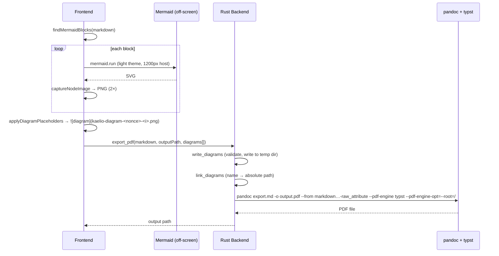

# 04-pdf-export

> **One export menu: PDF / DOCX / PNG.** **PNG** captures the rendered preview via `html-to-image` (full-width/full-height capture; forces preview mode so split panes don't clip it; long captures are sliced and stitched before the final crop). **PDF** and **DOCX** convert the Markdown source through the Rust Pandoc commands below and are Markdown-only: for an HTML file they are greyed out ("Markdown only", `exportAvailability` in `src/lib/export-availability.ts`). JPG and the image-based PDF (jsPDF) were removed.

PDF export converts Markdown to PDF via Pandoc with Typst. Mermaid diagrams are rendered to PNG **in the frontend**, with the same Mermaid instance the preview uses, before Pandoc runs. Nothing leaves the machine. Markdown tables are exported with explicit grid styling because Pandoc's default Typst table style is borderless.

## System Diagram



## 1. Mermaid rendering (frontend)

`renderDiagramsForExport` in `src/main.ts`:

- `findMermaidBlocks` (`src/lib/mermaid-export.ts`) finds top-level ```` ```mermaid ```` fences, following CommonMark fence rules (a longer outer fence hides inner ones; an unterminated fence is ignored).
- Each block is rendered off-screen on a white 1200px host. A source without an `%%{init` directive is prefixed with `%%{init: {'theme':'default'}}%%` so diagrams are readable on the white page whatever the app theme. The result is captured with `captureNodeImage` as PNG.
- A 16-hex-char nonce from `crypto.getRandomValues` names the images: `kaelio-diagram-<nonce>-<index>.png`.
- A block whose render or capture fails stays in the document as a plain code block (its fence loses the `mermaid` language). Export goes on.
- The status bar shows "Rendering diagram i/n…".

## 2. Diagram validation (Rust)

`export_pdf` and `export_docx` take `diagrams: Vec<DiagramImage { name, data_base64 }>`. `write_diagrams` writes them into the per-export temp directory (`$TMPDIR/kaelio_export_<pid>_<nanos>/`) only if every one passes:

| Rule | Value |
|---|---|
| `name` | exactly `kaelio-diagram-<16 lowercase hex>-<1–4 digits>.png` (no separators) |
| Count | at most 200 |
| Decoded size | at most 10 MB each |
| Content | starts with the PNG signature `89 50 4E 47 0D 0A 1A 0A` |
| Any failure | the call returns `Invalid diagram data` and removes files it already wrote |

`link_diagrams` then rewrites each `](<name>)` to `](<absolute path>)`.

## 3. Pandoc Pipeline

| Setting | Value |
|---------|-------|
| PDF engine | typst (full path from `find_typst()`) |
| Input format | `PANDOC_MARKDOWN_INPUT_FORMAT` + `-raw_attribute`: raw ```` ```{=typst} ```` blocks are printed as text, so a note cannot run Typst code such as `#read("/path")` |
| Typst root | `/` on macOS/Linux (`--pdf-engine-opt=--root=/`): Pandoc copies images into an absolute temp media folder, and Typst otherwise resolves that path under the working directory. Safe only with `-raw_attribute`. Not set on Windows (unverified there) |
| Margins | 1 inch |
| Font size | 11pt |
| Color links | true |
| Tables | 0.5pt light grid via temporary Typst header |
| PATH | Inherits system PATH and appends Homebrew and common bin paths |

Arguments are built by `pandoc_pdf_args()`; the test `pandoc_pdf_args_embed_an_absolute_path_image` runs the real tools when installed.

## 4. External Dependencies

| Tool | Required | Purpose |
|------|----------|---------|
| pandoc | Yes | Markdown → PDF/DOCX conversion |
| typst | Yes for PDF | PDF engine used by Pandoc (`brew install typst`) |

No network access is used. macOS setup:

```bash
brew install pandoc
brew install typst
```

MacTeX is not required.

## 5. UI Feedback

Status bar shows progress: "Rendering diagram i/n…" → "Exporting PDF..." (blue) → "PDF saved: filename" (green, 3s) or "Export failed: error" (red).

## File Reference

| File | Purpose |
|------|---------|
| `src/lib/mermaid-export.ts` | `findMermaidBlocks`, `applyDiagramPlaceholders`, `diagramName` |
| `src/lib/export-availability.ts` | Which exports a file kind allows |
| `src/main.ts` | `exportPdf`, `exportDocx`, `exportPng`, `renderDiagramsForExport` |
| `src-tauri/src/lib.rs` | `export_pdf`, `export_docx`, `write_diagrams`, `link_diagrams`, `pandoc_pdf_args` |

## Cross-References

| Doc | Relation |
|-----|----------|
| [02-preview-pipeline](02-preview-pipeline.md) | Same Mermaid instance, rendered in the preview |
| [03-file-operations](03-file-operations.md) | Shared file I/O patterns |
| [05-ui-layout](05-ui-layout.md) | Export menu in toolbar |
