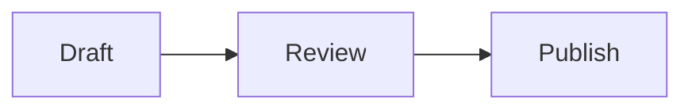

Kaelio's preview understands standard Markdown plus a handful of extras: Obsidian-style callouts, clickable checklists, Mermaid diagrams, KaTeX math, footnotes, wikilinks and YAML frontmatter. You write plain text; the preview does the rest.

## When to use it

- When you want a note, tip or warning box that stands out from the text.
- When you keep a to-do list in a Markdown file and want to tick items off in the preview.
- When a diagram or a formula explains something better than words.

## How to use it

### Callouts

Start a blockquote with the type in brackets, then put the content on the next lines:

```markdown
> [!tip] Optional title
> The content of the callout goes here.
```

Without a title, the callout is titled after its type. Supported types: `note`, `info`, `tip`, `hint`, `important`, `success`, `check`, `done`, `question`, `help`, `warning`, `caution`, `attention`, `danger`, `failure`, `fail`, `error`, `bug`, `example`, `quote`, `cite`, `abstract`, `summary` and `tldr`. Any other word also works, with a pin icon.

> [!NOTE]
> Callouts cannot fold (`[!tip]-` and `[!tip]+` are not supported). Give a callout at least one line of content under its title.

### Checklists

Write list items that begin with `- [ ]` (open) or `- [x]` (done). In the preview they become checkboxes. Click one to tick or untick it: Kaelio changes the matching line in the editor, and the change is saved like any other edit.

Use `-` bullets for checklists you want to tick from the preview. Items written with `*` or numbers still show a checkbox, but clicking may change the wrong line.

### Diagrams (Mermaid)

Put a Mermaid diagram in a fenced code block marked `mermaid`:

````markdown

````

Click a diagram to open it full screen. Scroll or double-click to zoom, drag to move, and press <kbd>Esc</kbd> or click **✕** to close.

### Math (KaTeX)

- Inline math: `$E = mc^2$`
- A display formula, on one line or across several:

```markdown
$$
\int_0^1 x^2 \, dx = \frac{1}{3}
$$
```

A dollar sign followed by a space, or a closing one followed by a digit, is plain text, so prices such as "$5 and $10" stay as written. To show a literal dollar sign next to text, write `\$`. Dollar signs inside code are never math.

If a formula has an error, the preview shows its source in red instead of failing the whole page.

### Frontmatter and tags

A YAML block at the very top of the file, between two `---` lines, is shown as a small table of properties above the text, not as raw YAML.

```markdown
---
title: Weekly notes
tags:
  - work
  - planning
---
```

Values under `tags`, `tag`, `categories` or `keywords` appear as pills. Tags can be written one per line, as above, or on one line as `tags: [work, planning]`. Click **×** on a pill to remove that tag from the frontmatter; the text of the note is never changed.

### Links, wikilinks and headings

- A normal link to a web page opens in your browser.
- A link to another Markdown file opens that file in Kaelio. Add `#heading-name` after the file name to jump to a heading in it.
- A wikilink `[[My Page]]` opens `My-Page.md` in the same folder as the current file (spaces become hyphens). Aliases (`[[page|alias]]`) are not supported.
- Hover a heading in the preview and click **¶** (**Copy link to heading**) to copy its anchor, for example `#weekly-goals`, to paste into a link.

### Footnotes, tables and images

- Footnotes use the usual syntax: `text[^1]`, then `[^1]: The note.` at the bottom.
- Wide tables scroll sideways instead of squeezing.
- Click an image in the preview to see it larger; click again to close it.
- Paste an image from the clipboard straight into the editor to add it to the document. Kaelio saves the picture in an `assets` folder beside the note (for example `assets/pasted-20261116-073501.png`) and inserts a relative link to it. PNG, JPEG, GIF and WebP images up to 20 MB are accepted, and an existing file is never overwritten. Save a new note once before pasting an image into it. Images paste into Markdown files only. If you switch tabs while the image is being saved, the file is still saved to `assets/` but no link is inserted; the status bar tells you.
- For pictures saved as files, keep them in your folder and link them with the usual Markdown image syntax and a relative path. If you replace a picture on disk, the preview shows the new version by itself.

### Editing tables

With the cursor on a line of a pipe table (a header row followed by a `|---|` row), <kbd>Tab</kbd> and <kbd>⇧</kbd><kbd>Tab</kbd> move between cells:

- <kbd>Tab</kbd> selects the next cell's text; in the last cell of the last row it adds an empty row.
- <kbd>⇧</kbd><kbd>Tab</kbd> selects the previous cell.
- Each press lines the columns up and rebuilds the `---` row, keeping alignment colons (`:---`, `:---:`, `---:`).
- `\|` and a pipe inside `` `code` `` stay part of the cell.
- A row with more cells than the header keeps the extra cells as written; they are not turned into new columns.

One <kbd>⌘</kbd><kbd>Z</kbd> undoes one press. Outside a table, and inside a code block, <kbd>Tab</kbd> indents as usual. Column widths are counted in characters, so wide characters such as Chinese or emoji can look slightly off.

### Line breaks

A single new line in your text is a line break in the preview. You do not need two spaces at the end of a line.

## What it will not do

- Diagrams and formulas render on your computer. Nothing is sent online to show them in the preview or to [export](../export/export.md) them.
- Raw HTML in a document is cleaned before it is shown: scripts, embedded objects and links that run code are removed.
- Code blocks in the preview are colour-highlighted when the fence names a common language (for example ` ```js ` or ` ```rust `); a block with an unknown or no language stays plain. Hover a code block and click **Copy** to copy its code.

## Next steps

- [The editor and the preview](editor-and-preview.md)
- [Export](../export/export.md) to share a finished document.
- [Keyboard shortcuts](../reference/keyboard-shortcuts.md)
